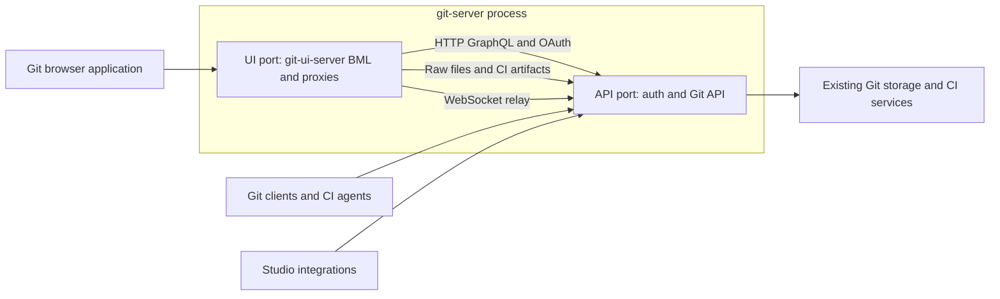

# BML Git application specification

Specification for the BML application hosted by `:git:git-ui-server`, based on the [Studio Git inventory](studio-ui-inventory.md). The separate `:git:git-ui` library owns the UI. `:git:git-server` owns Git GraphQL, authentication and Git transports; BML forwards operations over HTTP using its existing proxy. Move the full Git area out of Studio and remove embedded Git ownership from `:server:bosca-server` only after the remaining parity and backend separation gates pass.

The first release must provide a code workspace that fills the available page, a real CodeMirror editor, repository-aware Markdown images and links, distinguishable owner identities, and an Active repository list by default. This migration changes UI and server composition while preserving Git storage, CI execution, synchronization and domain authorization behavior.

## Implementation status — 12 October 2026

The BML UI now implements the inventoried screens in the separate `:git:git-ui` library. Authentication, repositories/editor/Markdown, pull requests/reviews, search/compare/statuses, CI/live logs, repository administration, agents and GitHub administration have compiled routes and typed server actions. [Parity validation](parity-validation.md) records measured checks, fixes and remaining acceptance gaps.

Git server hosts the UI's Git, GitHub, security, profile identity, owner search, pipeline and scheduler GraphQL schema and resolver wiring. Git UI server hosts BML pages, actions and assets on a second listener in the same Git server process. BML server operations use the HTTP GraphQL client; browser GraphQL/OAuth and subscription requests use same-origin proxies to the API. Studio and the main server composition remain in place. Deployed data, real provider/email flows, external synchronization, release optimization, external-service acceptance, backend separation and cutover are not established by fixture checks. No old UI or API is accepted for retirement.

## Scope and application ownership

UI source location: a new BML library project, `:git:git-ui`, with pages/components under `git/git-ui/src/main/bml` and client assets under `src/main/client`. `:git:git-ui-server` depends on this library and installs it into its application. The library owns BML compilation, generated operations and client bundling; the UI host module owns its routes and proxies. Git server depends on the host module and runs both listeners in one executable, with UI transport configuration under `git.ui.server`. Keep this specification and the Git feature inventory in `specs/git/`. The deployment supplies separate public UI and API/transport origins; no Sowers-specific host belongs in platform code.

Step 1 leaves Studio and `bosca-server` unchanged. Establish the separate UI with sign-in, an Active-by-default repository index, ref/directory browsing and read-only text display. The application uses BML's original endpoint-based integration for repository data and authentication. BML forwards credentials without validating them or sharing authentication state with the GraphQL engine. The current implementation also includes editing, numbered CodeMirror viewing, Markdown/image previews, owner selection and the remaining inventoried Git surfaces; their validation status is tracked separately. Move API ownership and verify HTTP GraphQL routing before removing Git from the main server.

The application owns every Git surface in the inventory: repositories, code and Markdown, commit/ref browsing, search and comparison, pull requests, CI catalog/runs/logs, repository secrets/settings, agents and shared GitHub mappings. Keep cross-domain administration and non-Git pipeline authoring in Studio. Studio's analytics/script/AI/pipeline repository selectors remain embedded integrations, with links opening the Git application where appropriate.

Moving Git composition out of `bosca-server` and replacing affected in-process consumers is in scope. Adding previously unexposed Git API features, redesigning auth, changing pagination, rewriting CI execution, or unrelated backend reorganization is outside this migration. Product decisions about fork, transfer, blame and other additional controls are separate from completing current feature parity.

## Git server ownership and main server separation

The Git server installs security routes, GraphQL HTTP/subscriptions, Git smart-HTTP/raw/LFS/webhook routes and CI routes. The Git UI server installs the BML application and forwards GraphQL, OAuth entry points, subscriptions, raw files and artifacts. The API validates credentials and authorizes each operation in its own request context. The main server currently owns Git and GitHub GraphQL namespaces, schema/dispatcher registration, Git implementation providers, queue configuration and Git email pipeline installers. Moving the UI alone would leave Git embedded in the main server.

The target requires:

- `git-server` owns the Git and GitHub GraphQL API, subscriptions and transport routes. `git-ui-server` owns the BML host and forwards to the API. Wire schema registrars, root namespace controllers, nested accessors and dispatcher registrars explicitly, with supporting schema dependencies verified against the actual SDL.
- Remove Git implementation module dependencies and provider registration from `bosca-server`, including transitive runtime implementations. Remove its Git/GitHub root namespaces, Git schema/dispatcher wiring, and Git-owned startup/queue/install configuration after their replacements are operational. Retaining contract models needed by another domain does not authorize retaining embedded Git implementations.
- Inventory every consuming domain before removal. Pipelines and AI use repository browse/write services; scripting and analytics use source-ref/sync services; WorkOps release/deployment services use repository and Git CI contracts. Provide authenticated remote operations through the established client abstractions or move Git-owned operations behind the Git server API. Preserve each domain's own business logic and the initiating principal, ACLs, Execute checks, failures and cancellation.
- Coordinate GraphQL client routing and generated operations with the API move. Existing Studio/CLI/SDK operations may combine Git and platform namespaces at one endpoint; split or route those operations explicitly to the owning API. Document the client-visible schema/endpoint change and release order before removing namespaces; do not silently leave a duplicate local Git implementation to preserve the old endpoint.
- Make transaction and retry boundaries explicit where a formerly local Git call becomes remote. Do not assume the main server's database transaction can roll back a committed Git server mutation. Test partial failures and retries against the agreed workflow contract before cutover.
- Assign Git jobs, migrations, package installers and event consumers to their intended execution roots. `bosca-runner` currently loads Git implementations too; audit its existing ownership so moving the API does not duplicate or abandon CI, synchronization or maintenance work. Removing all Git from the runner is not implied by this requirement to remove it from `bosca-server`.
- Relocate Git-specific email pipeline seed composition out of the main server while retaining ordinary platform email delivery and editable pipeline behavior. Keep non-Git pipeline authoring in Studio. Trace notification origin configuration and existing installed seeds as part of the move.

Completion means `bosca-server` starts and serves its remaining domains with no embedded Git implementation or local Git API. Studio integrations and cross-domain workflows use the Git server's API instead of relying on the removed namespaces. The physical repository data stays in the existing storage; separating server composition does not require a new repository store.

Source evidence: [Git server startup](../../git/git-server/src/main/kotlin/bosca/git/server/Application.kt), [Git server build](../../git/git-server/build.gradle.kts), [main server composition](../../server/bosca-server/src/main/kotlin/bosca/server/Application.kt), [main server GraphQL wiring](../../server/bosca-server/src/main/kotlin/bosca/server/graphql/BoscaGraphQLService.kt), [Git email installer](../../server/bosca-server/src/main/kotlin/bosca/server/installer/DefaultGitEmailPipelinesInstaller.kt), and [WorkOps release consumers](../../workops/workops/src/main/kotlin/bosca/workops/service/ReleasePipelineServiceImpl.kt).

## Navigation and routes

Use Studio’s compact sidebar and page-header design with Repositories, Pull Requests, Pipelines and Search. Match Studio’s dark tokens, Git accent, typography, tabs and table treatment; verify rendered screens rather than accepting source similarity as visual parity. Put CI Agents and GitHub User Mappings under Git Settings with their current authorization rules. Repository navigation retains Code, Commits, Branches, Tags, Pull Requests, Pipelines, Statuses, Secrets and Settings. Comparison is reachable from repository/ref context and a direct link.

| Proposed app route | Purpose |
| --- | --- |
| `/repositories?owner={profileId}&state=active` | Repository index; Active when state is absent. |
| `/repositories/{id}` | Repository workspace; preserve `tab`, `ref`, `path`, `file` and `setting` query semantics for navigation mapping. |
| `/pulls` and `/pulls/{id}` | Global PR list and PR detail; accept current `repo` and `number` context. |
| `/pipelines` and `/pipelines/{id}` | Global Git CI catalog and run detail. |
| `/search` and `/compare` | Search and ref comparison, with selection/filter state in the URL. |
| `/statuses` | Cross-repository commit status inspection. |
| `/ci-agents` and `/ci-agents/{id}` | CI agent administration. |
| `/settings/github` | Shared GitHub user mappings. |
| `/login`, `/404`, `/500` | Sign-in and application error pages. |
| `/{owner}/{repo}/raw/{commitSha}/{path}` | Existing Git server raw-file route, served on the UI origin; explicit remaining-path matching. |

Keep selected owner, ref, path, file, tab, settings panel and relevant list filters addressable in URLs. Refresh and browser Back/Forward restore the same view. A remembered owner is a fallback only when the URL does not select one. A bare repository list always starts Active; a bookmarked All or Archived view stays explicit in its URL. Preserve repository UUIDs, PR identities and run IDs throughout the move.

## Repository list and identity selection

Default to Active, excluding archived and deleted repositories. Offer Archived and All as explicit choices; All contains active and archived repositories, excluding deleted ones. Request `includeArchived: false` for Active and true where archived data is needed. Do not turn deleted repositories into another ordinary list by accident. Show counts from an appropriate query; an active-only response cannot supply an archive count.

Retain create/import, visibility/content type/default branch fields, remembered owner, archive/restore and soft-delete. Preserve existing backend semantics for restore and archive actions after verifying their implementation. Distinguish an empty repository list from an unavailable owner or failed query.

Owner selection identifies Profiles. Show display name and `@slug` together in the menu and selected value. If no slug exists, show enough of the Profile ID to distinguish results, with the full value accessible. Emails may be an additional identifier only where already accessible and appropriate; do not require exposing private email to distinguish names. GitHub mapping selectors identify Principals and must use the corresponding account identity rather than substituting a Profile ID.

Give the owner control a stable responsive width independent of selected-label/search-input replacement. The menu is at least the trigger width where the viewport permits, supports long labels without hiding their distinguishing text, and stays within the viewport. Maintain selection across searches, loading and reopening. Provide keyboard navigation, an accessible combobox/listbox relationship, visible loading/errors and no-result feedback. Ignore stale search responses.

## Code workspace and editor

Use a full-height application shell and repository workspace. A compact repository/ref/file toolbar sits above a directory tree and the file surface. The file surface fills the remaining width and height, including for empty and one-line files. On smaller screens the tree can collapse without reducing the editor to a short form field.

The workspace owns its outer boundary. The editor body has no second border, radius or inset card. CodeMirror's editor and scroller fill the allocated surface; the scroller owns long-file vertical and horizontal scrolling. Use flex/grid constraints and `min-height: 0` through the parent chain rather than estimating height from line count or capping it at 800px. Keep commit controls visible while the edit buffer scrolls.

Initialize CodeMirror 6 in a BML client island. Load editor code on code surfaces rather than every app page, preserve the buffer across unrelated fragment updates, and destroy the instance on unmount. Use the existing language-detection vocabulary and CodeMirror language support, with plain text as an explicit fallback.

Required editor behavior:

- Visible line numbers in viewing and editing, syntax highlighting, active-line indication, bracket matching and indentation.
- Keyboard find/go-to-line, undo/redo, folding where the language supports it, and a wrap toggle. Keep a way to move keyboard focus out of the editor.
- Read-only mode prevents changes. Edit/create mode presents the target branch, author identity, dirty state and commit message.
- File creation, editing, deletion and folder creation use the same author resolver as the editor preview. Prefer the primary profile, then the first profile; use its name or slug. Match Studio's neutral author fallbacks (`Studio User`, `studio@bosca.io`) when profile fields are absent or the email attribute is malformed. Missing profile metadata must not block an otherwise authorized commit, including the initial administrator's first README.
- Preserve file/folder creation, editing, rename and delete using current mutations; surface failures without discarding the draft. Warn before navigation/ref changes or tab close discard unsaved work.
- Preserve branch protection and authorization failures. Tags and detached commits are browse targets; writes select a branch rather than treating every ref as writable.
- Keep search line numbers addressable and scroll the viewer to a selected line. Render an empty text file as an empty numbered editor rather than an ambiguous loading/error state.

The rebuild must inspect current write/concurrency contracts before claiming stale-edit rejection. Do not promise it from a client-side ref check alone. If the API cannot provide the agreed edit contract, record the narrowly scoped API requirement before changing it.

## Markdown previews and assets

Render conventional root README files in repository overview. All supported Markdown files get Preview and Source modes, including nested documents. Edit mode offers a preview of the draft. Source uses the same numbered code viewer; prose uses readable line lengths, responsive tables and images with preserved aspect ratio.

The renderer receives repository identity, selected ref, resolved commit SHA and document path. Resolve relative destinations against the document's directory at that commit, not against the web page URL. Rewrite images to the app's raw delivery route and local document/file links to the matching repository viewer. In repository Markdown, `/images/logo.png` means a repository-root path. Preserve fragments for document anchors and avoid rewriting external HTTP(S) links as repository files.

Examples:

| Markdown location and destination | Required resolution |
| --- | --- |
| `README.md` with `./docs/images/banner.png` | `docs/images/banner.png` from the README's resolved commit. |
| `docs/guide.md` with `../images/diagram.png` | `images/diagram.png` from that same commit. |
| `docs/guide.md` with `/assets/logo.png` | `assets/logo.png` at repository root. |
| `docs/guide.md` with `./setup.md#install` | Repository viewer for `docs/setup.md`, preserving ref context and heading anchor. |
| External HTTPS image or link | External destination, without sending Bosca authorization headers. |

Use a Markdown parser and structured destination transformation, not a regular expression over Markdown source. Preserve ordinary Markdown image syntax, reference-style images, alt text, titles and escaped paths. Normalize `.` and `..` within the repository and reject escape above its root. Encode URL path segments correctly, including spaces, Unicode and literal reserved characters. Resolve branch/tag names to commits before constructing raw URLs, covering refs containing `/`.

Treat repository Markdown as untrusted. Keep raw HTML and arbitrary component execution disabled initially, matching current behavior. If the reported image uses ``, make the supported syntax explicit and decide whether a narrowly sanitized HTML subset is needed; do not enable all HTML to repair one image. Render missing/denied images with meaningful alt/error feedback without breaking surrounding prose. Tokens do not belong in image URLs.

## File delivery and previews

Git server serves raw bytes with View permission checks. Git UI server streams these routes on the UI origin, forwarding the browser’s credentials and origin to the existing API route without interpreting them. An image element cannot attach the SDK bearer header itself; verify cookie authentication and custom prefixes through the proxy. Authorization stays with the API, and tokens never belong in URLs.

Resolve repository UUID to current owner/repository slug through the authorized API. Build the existing raw URL at an immutable commit SHA and retain streamed bytes, meaningful status/content type and client-disconnect handling. Apply private cache behavior to authenticated repository data; do not let a public asset cache bypass repository access after permission changes. Route registration must keep raw Git data distinct from BML page routes and public bundled assets.

Offer inline previews for supported raster images, and Raw/Download for files that cannot be edited inline. Do not serve repository HTML or executable content as trusted app documents. Decide SVG handling deliberately so repository-authored active content cannot run in the authenticated application origin. LFS pointers need explicit handling: a resolved LFS image preview is accepted only after its ordinary permission-checked delivery path is verified; otherwise display a clear pointer/download state.

Preserve the current inline text limit unless a separate change is agreed. Distinguish oversized text from binary where the API allows it. The current blob flag conflates them; an additive blob metadata field may be required for accurate messaging. The rebuild must not label every file over 1MiB as a true binary. Preview/download must bypass the GraphQL inline-content limit using streamed transport.

## Pull requests and CI parity

Port the workflows in the inventory as explicit BML pages/components rather than transplanting the large Vue repository page. PR parity includes draft/ready transitions, reviews, inline threads, assignees, dependencies, merge-plan review and all supported merge actions. Keep diff truncation visible and offer existing expansion behavior. Branch protections, reviewed source and required CI remain backend decisions.

Git CI parity includes manual ref/input selection, typed inputs, run/job/step status and failures, requirements, build-anyway reasons, cancel/rerun actions, artifact downloads, run deletion and agent navigation. Distinguish repository Edit from Execute; permission-aware controls must not imply editing grants build execution. Job approval is supported by the API but has no control in the inspected Git pages; decide whether to add it separately rather than misclassifying it as existing UI parity.

Preserve the current `/ci/artifacts/{repositoryId}/{runId}/{name}` download workflow using Git server's existing CI routes on the UI origin. Validate browser-session authorization, streaming and disposition; no Studio proxy should be needed in the target deployment.

Preserve status polling for active runs and agents through BML server actions/contracts. Stop it when terminal or unmounted. Preserve historical log tail, earlier-log paging, stream identity, line numbers, pause/follow and scroll position. Existing live step logs use `graphql-transport-ws`; install the Git GraphQL subscription transport in `git-server` and connect directly on the UI origin with the established connection-init authentication. Prove the transport in the API integration milestone; polling alone is not live-log feature parity. Reconnect without duplicating output or losing historical access, and stop subscriptions on terminal steps/sign-out.

## Administration parity

Keep settings in the current repository context. Preserve webhooks, protection rules, permissions granted to groups, storage utilities and repository secret management. Secret values stay write-only and out of rehydrated state; agent registration tokens remain one-time displays. Retain current confirmation flows for consequential actions.

GitHub controls retain immutable provider identity lookup, pairing versions, enable/disable behavior, secret selection and creation, branch include/exclude filters, delivery diagnostics, paged ref/PR history, explicit pull/push/reconciliation and conflict resolution with reviewed values. Keep administrator-only shared mappings and history rules. Pairing and mappings do not confer repository permissions, and an accepted delivery is not presented as completed synchronization.

GitHub synchronization graphs and shared Pipeline secrets remain owned by their existing Studio surfaces. Link to them from Git instead of rebuilding the non-Git pipeline system in this application.

## BML implementation architecture

### Local components and later Bosca UI extraction

Git functionality is the current delivery priority. Keep reusable controls and layout in local `git-ui` components now, with Git views and operations separate. Pages own routes and data loading and compose components. Generic controls have typed props, slots and scoped presentation; theme values stay in an ordinary CSS file. Keep native forms, accessibility attributes and client-island refs working through component boundaries. Preserve a file workspace that fills the available page without an extra rounded card.

Build the later Bosca BML UI library by extracting components proven in Git. A proposed module is `:bml:bosca-ui`, eventually consumed by `:git:git-ui`, giving the dependency chain `git-ui-server` → `git-ui` → `bosca-ui`. Repository layout, authentication and domain operations stay in `git-ui`. Creating the shared project, dependency-import support and a broader design-language component catalog are deferred; none blocks the Git milestones.

Use the existing [Bosca UI theme variables](../../web/packages/ui/src/styles/variables.css) as the shared source for colors, light/dark themes, typography, radii and brand overrides. Package the CSS into the BML library so deployed applications do not need a Nuxt installation or workspace files. BML components implement the same design language with native HTML and BML behavior. Keep the theme values in one source rather than maintaining a separate Git palette.

Begin with the primitives the current Git pages need: application/page shell, page heading, button, text field, form field, badge and navigation tabs. Proposed tags use a `bosca-` prefix, for example `<bosca-button>` and `<bosca-page>`, so application-specific tags remain distinct. Use typed props and slots, preserve native form and accessibility semantics, and compose Git-specific tags from these primitives. The workspace shell must allow its content to fill the remaining height and must not impose an extra rounded card on code surfaces. Add more controls when a real application needs them.

The library owns shared presentation and reusable control behavior. Applications own navigation destinations, authentication, GraphQL operations and domain state. The shared UI library does not depend on Git, Nuxt/Vue or a particular server composition root. Apps can supply brand-variable overrides and use shared tags alongside their own component library.

Provide explicit dependency component imports in BML rather than copying shared `.bml` files into each application. The current compiler discovers component declarations only in its compilation's source roots and emits registries into a fixed `bml.generated` package; the Gradle `packageName` setting is not currently passed through to that compiler. Library consumption must resolve tags and typed props during compilation, avoid generated-class collisions, and include the referenced components' transitive CSS and client modules in the consuming site's asset pipeline. Runtime renderer registration alone does not satisfy this contract. Use the existing compiler, component metadata and bundler abstractions; reuse the compiler and asset metadata when importing shared controls; extraction does not add another server.

When extraction is scheduled, prove a separate custom library consumed by a BML application: typed/static props, slot content, declarative actions, scoped CSS, client-module delivery, dependencies between components and explicit duplicate-tag behavior. Move the reusable controls at that point and repeat Git's HTTP, TypeScript and desktop/mobile checks. The local component work leaves Studio and the main server unchanged. BML retains its HTTP GraphQL client and proxy; no local backend is required.

Use `apps/profiles-web` as the source example for BML compilation, generated GraphQL operations, auth and component registration, adapting these into the `git-ui` library. Its install function receives the UI server application and the configured Git GraphQL HTTP endpoint. BML pages/components supply the full document skeleton; template/layout declarations must not be assumed to implement it. Declare scripts as server or client. Keep app/theme CSS in actual CSS sources and use scoped styles for components.

Use declarative `@click`/`@submit` islands for normal actions and generated typed contracts for client widgets that need server requests. Client islands do not call GraphQL directly. Page loaders and action handlers execute typed operations under the caller's authentication against the Git server API; the Git application's security/profile/owner-search operations use the locally composed domain resolvers. Other domains remain with their owning applications. Make these destinations explicit rather than loading every platform implementation into `git-server` to satisfy page queries.

CodeMirror, identity search and live-log widgets own their small client lifecycle. Avoid replacing the editor or transmitting its full draft on every surrounding status refresh. Client-posted state, route IDs and selected identities are untrusted inputs; backend GraphQL controllers retain boundary authorization on every action.

Follow the established browser SDK refresh and BML auth gate, same-origin GraphQL route, public login and one-time cross-domain exchange flow. Preserve return URLs, custom cookie prefixes and local development. Sign-out clears private island state. Authenticated repository responses remain private; do not enable shared BML page caching for caller-dependent Git content.

Use Studio's authentication presentation and flow behavior as the baseline, implemented with local BML components. Provide password and Google sign-in, signup with typed name/email profile attributes, verification and resend with cooldown, password recovery/reset, and account linking with the backend's offered PASSWORD/EMAIL proofs. Signup does not create a session: verified accounts must complete sign-in before navigating to Git. Handle unverified sign-in by continuing to verification. Keep friendly errors, loading states, password-strength feedback, responsive layouts and working navigation between flows. Public email landing routes are `/auth/verify`, `/auth/reset-password` and `/auth/link/confirm`, matching the platform's email-link contract. Preserve the original destination across these flows and keep the OAuth callback public so exchange tokens reach the SDK. Shared library extraction remains deferred.

BML exposes `install(BoscaApplication)` for composition. Install the compiled UI into the dedicated `git-ui-server` application. Run its Netty engine on a second port in the same `git-server` process, and reuse BML's existing HTTP GraphQL/OAuth proxies. Relay raw files and CI artifacts without buffering complete downloads, preserving credentials, status, MIME and security headers.

The API application alone registers and shuts down process-wide DI services; the UI application owns only its router, middleware, shutdown hooks and coroutine scope. Start the API before the UI; use the API’s actual bound port for loopback GraphQL, file and subscription proxies. Drain the UI before stopping the API. Binding or initialization failure stops both listeners. Keep this lifecycle composition in Git; BML needs no internal execution or authentication hooks.

Git server's `GraphQLModule` owns `/graphql` and `/graphqlws`; its security routes own OAuth callbacks and credential validation. UI-side BML loaders, actions, contracts and fragments use `GraphQLClientFactory` with the loopback HTTP endpoint. Browser SDK requests use BML's same-origin `/graphql` proxy, which forwards origin and session response cookies. UI subscriptions at `/_git/subscriptions` relay to the API's `/graphqlws`. Shared BML shells execute anonymously; each HTTP operation receives fresh authentication state, including when a server operation overrides its token.

Use root Gradle project paths and Java 25. Bundle BML client assets with the combined Git server JVM/native package and validate its reachability/resource metadata. Run project and dependency validation from the workspace root without intermediate Maven Local publication. Never edit generated BML/KSP output.

## Cutover and operation

Deploy Git UI server alongside the Git API and current Studio routes first. Configure the UI public origin for UI links and preserve transport URLs where routing permits; existing clones must continue to work or have an explicit remote-update path. Keep local development valid with one Git server command and configured local infrastructure. The UI defaults to port 8093 and the API/transport server to port 8091. Choose branding through application configuration and the real brand mark.

Map every old `/git/...` UI route and its query context to its new destination. This is a proposed UI-link migration mechanism; it does not require preserving duplicate application logic or introducing internal service overloads. Inventory consumers before agreeing the duration of legacy redirects. Do not redirect Git smart-HTTP, LFS or webhook traffic with UI routes.

Update Studio's subsystem entry, command palette, release/run links, synchronization recovery links and domain-owned source links. Update the Git transport browser redirect and actual notification URL producers. Review persisted installer-backed templates; if seed changes are needed, update both package and installer versions idempotently without overwriting user customizations.

Retire Studio Git pages and the main server's embedded Git composition only after their respective parity and separation checks pass. Keep embedded repository/file selectors in Studio where their domain workflows need them, retargeted to the Git API. Define rollback for both UI navigation and API/server ownership using matched deployment versions, migration compatibility and explicit queue/listener ownership. A navigation-only rollback is insufficient after removing Git from the main server. Retain unsaved local drafts during a user session rather than redirecting active editors midway through a rollout.

## Delivery sequence

| Milestone | Deliverable and completion gate |
| --- | --- |
| 1 UI foundation | New `:git:git-ui` BML library installed by `:git:git-ui-server`; separate UI and API listeners in one process; packaged browser assets; SDK sign-in/sign-out and same-origin proxy to the configured existing API; Active default; read-only repository/ref/tree/text browsing. Real HTTP tests prove page authentication, token forwarding, filters, escaping and asset delivery. Studio and main server remain unchanged. |
| 2 API integration | Git GraphQL schema/controllers/dispatchers/subscriptions hosted by Git server; HTTP BML operations and same-origin browser proxies with API-owned authentication routing; authenticated raw image, artifact and live-log checks. Prove routing and auth contracts before relying on them for broader UI functionality. |
| 3 Repositories and code | Active default, stable distinguishable owner picker, listing/create/import/lifecycle, complete code workspace/write flows, Markdown preview/resolution, supported image previews, URL/dirty-state behavior. Pass layout and asset acceptance cases below. |
| 4 Pull requests and search | Repository/global PR views and actions, diffs/reviews/dependencies, search/compare/statuses. Verify each workflow against current source and behavior. |
| 5 CI and administration | Catalog/runs/logs/inputs/requirements/artifact downloads/agents/secrets plus all settings and GitHub panels. Pass real auth and transport integration checks. |
| 6 Backend separation and cutover | Authenticated cross-domain Git clients and workflow tests; migration/job/installer ownership; remove embedded Git dependencies/providers/API from `bosca-server`; complete route/link matrix, a combined Git server package and independent UI module, agreed legacy links and matched-version rollback; remove old pages only after all gates pass. |

## Acceptance and validation

| Area | Required checks |
| --- | --- |
| Editor layout | At 1440×900 and 1024×768, one-line, empty and long files fill the available workspace; resize updates it; no second editor border/radius; long content scrolls inside the editor. At 390px width, controls remain usable and the collapsed tree leaves a useful file surface. Browser tests measure geometry and capture screenshots. |
| Editor behavior | Line numbers in read/edit/create; syntax support and plain-text fallback; find, go-to-line, undo/redo and wrap; commit success/failure; draft preserved after failure; dirty navigation/unload; ref/file switches; read-only enforcement. |
| Owner selection | Two identical names with different slugs remain distinguishable; absent slug fallback; long selected label; async loading, error, stale response, reopened picker and keyboard selection; closed/open trigger width differs by at most 1px at the same viewport. |
| Repository defaults | Bare index excludes archived and deleted data; explicit Archived/All works; owner/ref/filter state survives refresh and Back/Forward; unauthorized owner and query failure are distinct from zero repositories. |
| Markdown | Root/nested README and Markdown Preview/Source; relative/root paths, reference images, spaces, Unicode, fragments and parent segments; refs containing slashes; image loaded from the same resolved commit as the document; missing/denied assets do not destroy prose. Unsafe HTML/component execution stays disabled. |
| Supplied repository | Read-only check of the reported repository after identifying its actual image syntax/request: image renders or a precise unsupported-format/auth/path failure is visible. Use a fixture reproducing the confirmed syntax for automated regression coverage. |
| Raw delivery | Real authenticated image request, correct bytes/MIME, denied View, token refresh/custom cookie prefix, no credential query string, private cache behavior and disconnects. Validate oversized file streaming, unsafe file disposition and chosen SVG/LFS behavior. |
| PRs and permissions | Draft/review/comment/thread/assignee/dependency/merge lifecycle, required checks and protected branches; unauthorized reads/writes; Profile/Principal distinction and group grants preserved. |
| CI and agents | Active and terminal states; actual log subscription through the app host, reconnect, earlier paging and scroll/pause; Execute distinct from Edit; build-anyway/rerun/cancel; authenticated artifact downloads; failure details and one-time tokens; polling/subscription cleanup. |
| GitHub administration | Admin and non-admin cases; missing secrets, version races, filters, failure recovery, real API-backed pairing and isolated synchronization tests; reviewed conflict resolution rejects stale observations. |
| Server composition | BML runs in Git UI server; Git GraphQL HTTP/subscriptions, auth, raw/LFS/CI and smart transport run in Git server. No local GraphQL backend, `/graphql` handler collision or self-proxy loop. Verify JVM/native startup and bundled assets. Main server runtime dependencies and provider wiring contain no Git implementation; its remaining domains start and work after separation. |
| Cross-domain workflows | AI/pipeline source edits, script/query synchronization, WorkOps release/deployment actions, Studio selectors and Git email pipelines retain caller identity, permissions, retry/failure behavior and event ownership through the Git server API. Explicitly test remote-call partial failures and job redelivery. |
| Cutover | Every inventoried old route/query maps correctly; real notification/link producers use configured origins; clone/push/LFS/webhook routes continue to work; rollback restores navigation without changing repository data. |

Unit tests cover path resolution, identity formatting, route mapping and action/input state. Browser tests cover real editor/combobox geometry, image loading and BML lifecycle. Wiring-heavy auth/raw/log behavior needs integration coverage using real server components and the required infrastructure; PostgreSQL fixtures use the established pgvector image where migrations require it. Mutation checks use isolated test repositories, not ordinary deployed records.

Run focused `:git:git-ui:check`, `:git:git-ui-server:test`, `:git:git-server:test`, the library’s BML compile/client-bundle tasks and relevant dependency tests from the workspace root after integration, followed by Git server JVM/native packaging and integration/browser suites. Validate `:server:bosca-server` compilation/startup and each affected domain after separation, and audit runner registrar parity where shared providers change. Report successful commands, failed checks and coverage gates separately. Existing mocked Studio tests are references to port, not proof that the new application meets acceptance.

## Decisions to settle before implementation

- Scope is the full Git area, delivered in steps; begin with the separate UI host and component library while leaving Studio and the main server unchanged.
- Choose the Git server's public UI/transport origin, deployment branding and initial navigation target.
- Decide whether anonymous public-repository browsing is part of the first release. Default draft behavior follows authenticated Studio access while preserving backend visibility rules; anonymous browsing requires an explicit route/auth design.
- Reproduce the specific Markdown image failure to settle any HTML, SVG or LFS requirement beyond ordinary Markdown raster images.
- Agree legacy UI link handling and duration at cutover; settle any narrowly identified GraphQL metadata/write gaps separately.

The reusable controls and their Nuxt references are specified in [BML UI components](bml-ui-components-spec.md). Git-specific models, profile search and server actions stay outside those controls.
